# FinTrack
FinTrack is an iOS personal-finance app built with **SwiftUI**, **Core Data**, and an **MVVM + Repository** architecture.
<table>
  <tr>
    <td align="center" width="50%">
      <strong>Dashboard</strong>  
      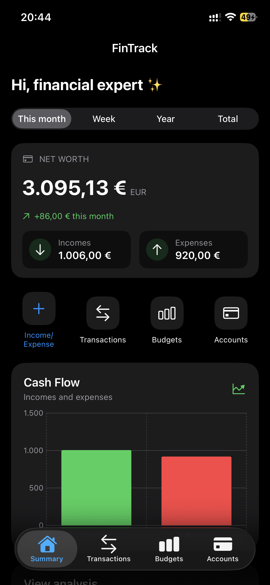
    </td>
    <td align="center" width="50%">
      <strong>Analytics</strong>  
      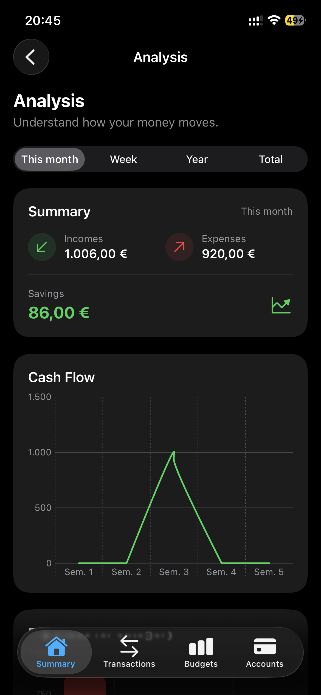
    </td>
  </tr> 
</table>

## Features

- Create and manage accounts with an initial balance.
- Record income and expenses linked to an account and category.
- Edit and delete transactions while recalculating the account balance.
- Browse dashboard and analytics views.
- Create and manage category-based monthly budgets.
- Store data locally with Core Data.
- Seed default categories without recreating categories that already exist.

## Tech stack

- Swift / SwiftUI
- Core Data
- Charts
- MVVM
- Repository pattern
- XCTest 

## Requirements

- macOS with a compatible version of Xcode
- iOS Simulator or an iPhone for manual testing

The exact minimum iOS version is defined in the Xcode project settings.

## Run the app

1. Clone or download this repository.
2. Open `FinTrack.xcodeproj` in Xcode.
3. Select the `FinTrack` scheme and an iOS Simulator.
4. Build and run with **⌘R**.

The app stores its data locally using Core Data. For a clean manual test, remove the app from the simulator or reset its content using the simulator's device settings. This deletes local test data.

## Testing
See [`TEST_PLAN.md`](TEST_PLAN.md) for the test cases and manual acceptance checklist.

## Architecture

- **Views**: SwiftUI screens and reusable UI components.
- **ViewModels**: presentation state and actions exposed to the views.
- **Repositories**: Core Data operations for accounts, transactions, and budgets.
- **Models**: Core Data managed objects and supporting types.
- **Core/Persistence**: Core Data stack and initial category seeding.

## Screenshots

Explore FinTrack in both dark and light appearance.

### 🌙 Dark Mode

<table>
  <tr>
    <td align="center" width="50%">
      <strong>Dashboard</strong>  
      
    </td>
    <td align="center" width="50%">
      <strong>Dashboard — Overview</strong>  
      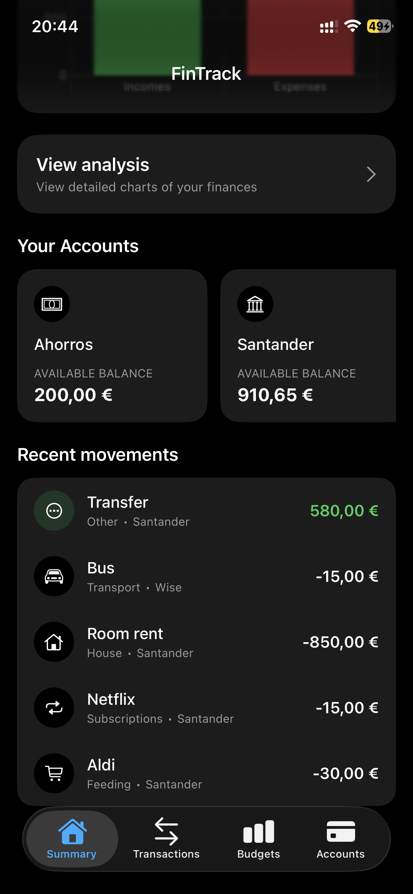
    </td>
  </tr>
  <tr>
    <td align="center">
      <strong>Accounts</strong>  
      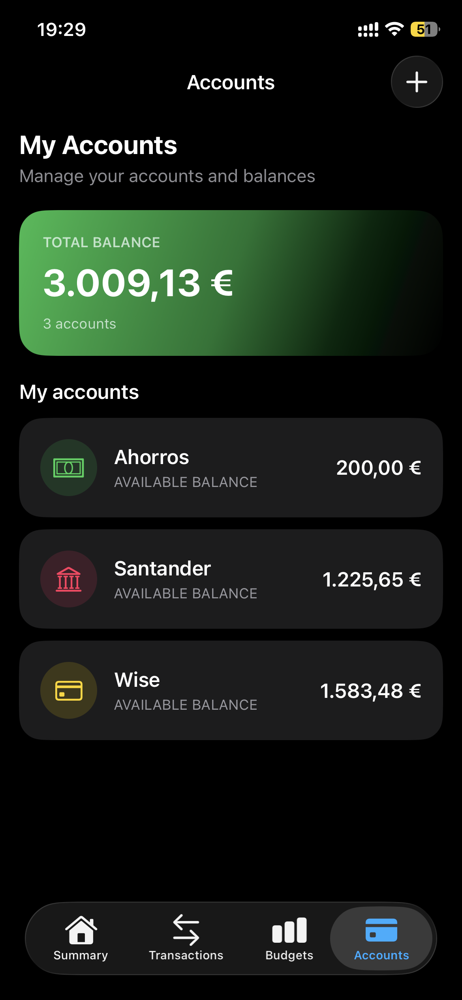
    </td>
    <td align="center">
      <strong>Edit Account</strong>  
      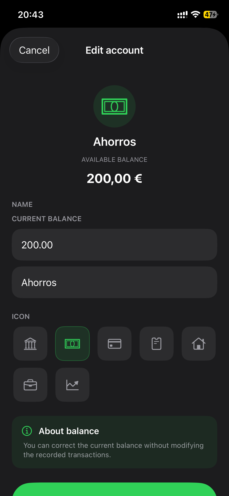
    </td>
  </tr>
  <tr>
    <td align="center">
      <strong>Transactions</strong>  
      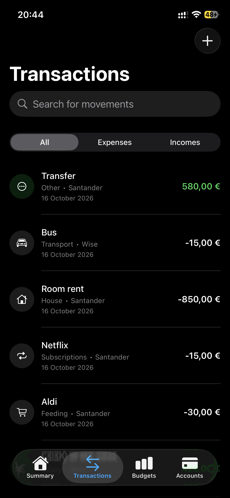
    </td>
    <td align="center">
      <strong>Edit Transaction</strong>  
      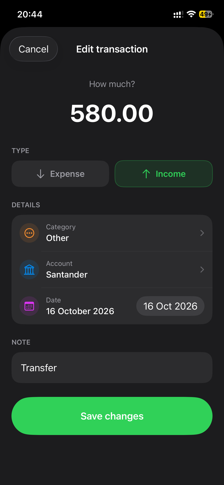
    </td>
  </tr>
  <tr>
    <td align="center">
      <strong>Budgets</strong>  
      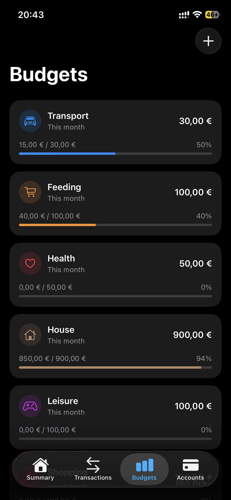
    </td>
    <td align="center">
      <strong>Add Budget</strong>  
      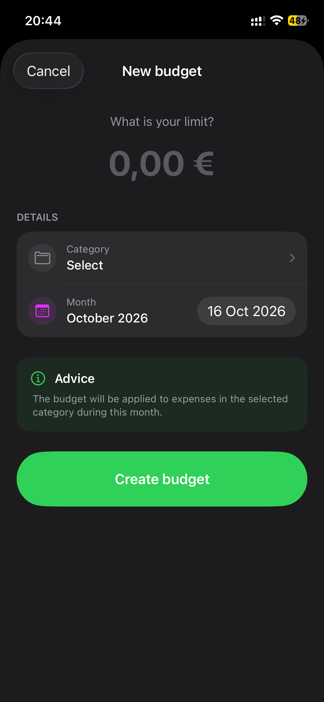
    </td>
  </tr>
  <tr>    
    <td align="center">
      <strong>Analytics</strong>  
      
    </td>
  </tr>
</table>

### ☀️ Light Mode

<table>
  <tr>
    <td align="center" width="50%">
      <strong>Dashboard</strong>  
      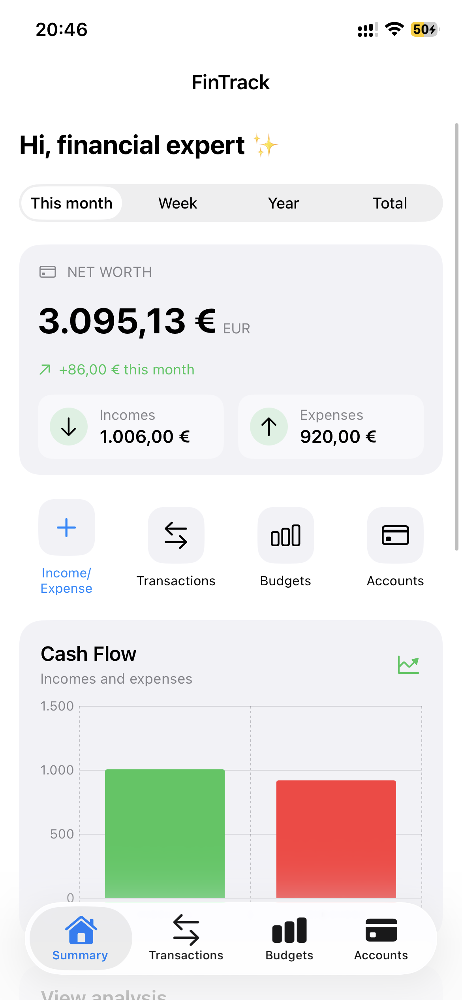
    </td>
    <td align="center" width="50%">
      <strong>Dashboard — Overview</strong>  
      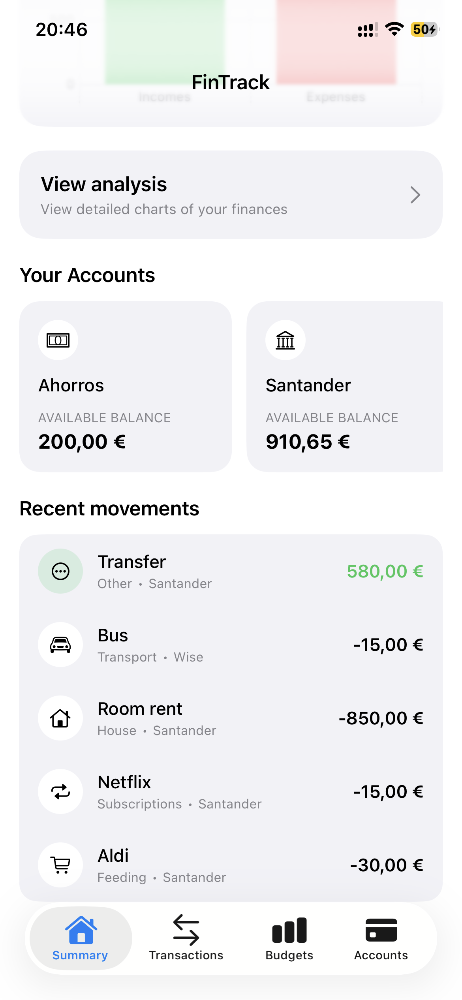
    </td>
  </tr>
  <tr>
    <td align="center">
      <strong>Accounts</strong>  
      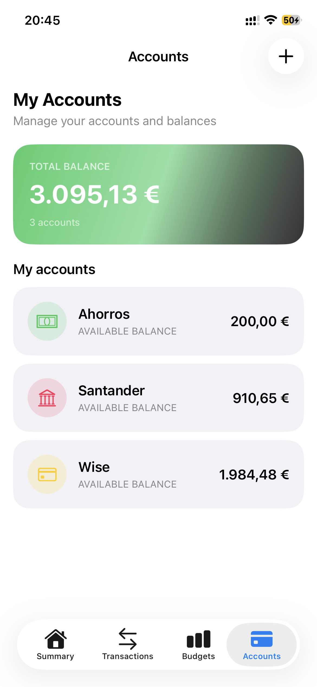
    </td>
    <td align="center">
      <strong>Add Account</strong>  
      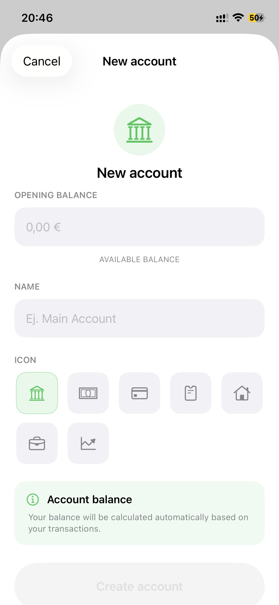
    </td>
  </tr>
  <tr>
    <td align="center">
      <strong>Transactions</strong>  
      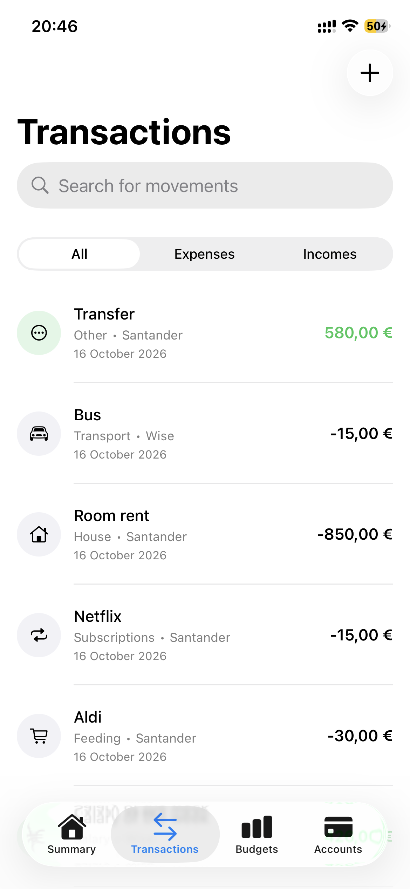
    </td>
    <td align="center">
      <strong>Add Transaction</strong>  
      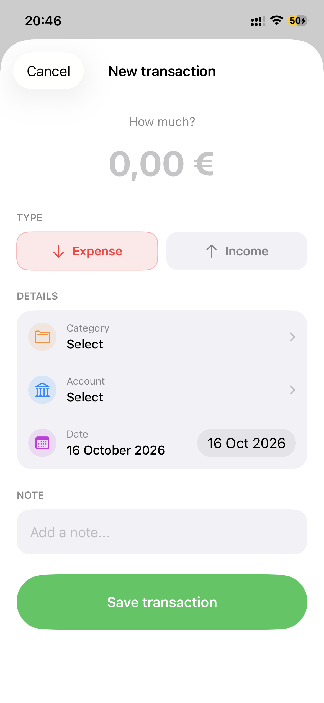
    </td>
  </tr>
  <tr>
    <td align="center">
      <strong>Budgets</strong>  
      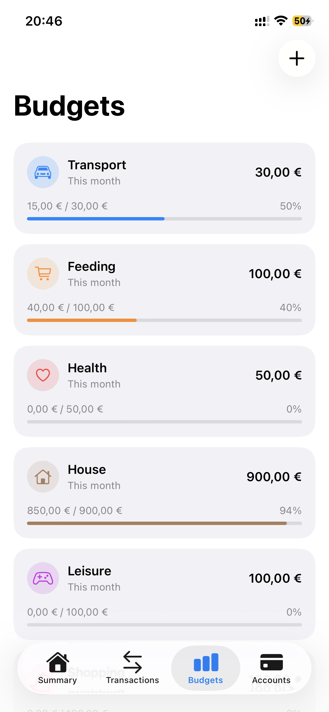
    </td>
    <td align="center">
      <strong>Analytics</strong>  
      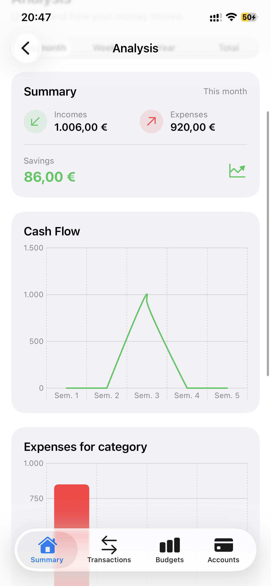
    </td>
  </tr>
</table>

